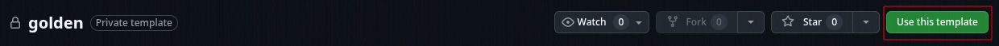
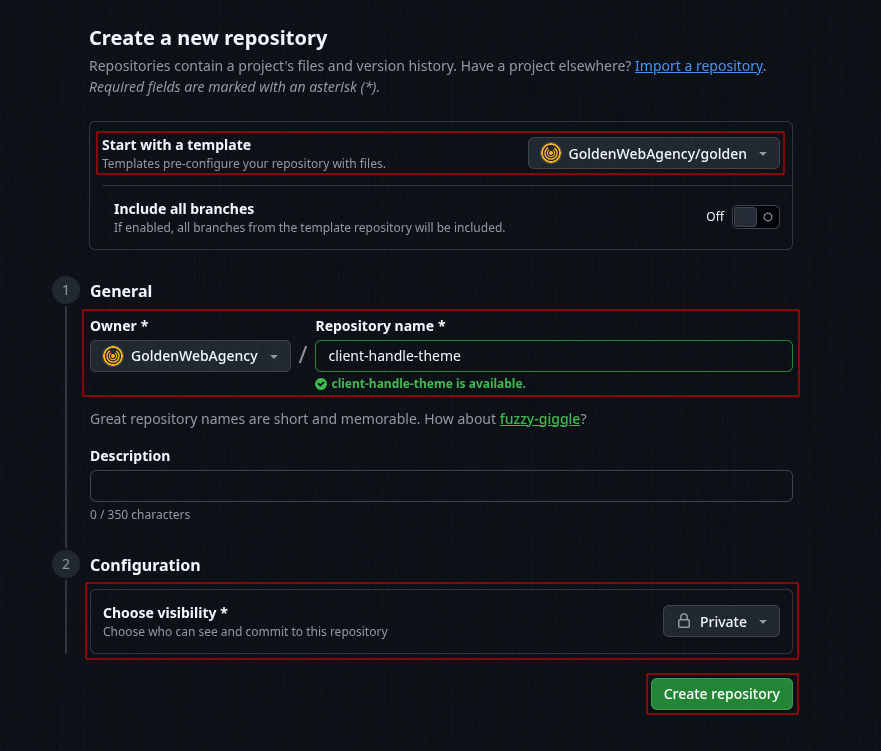
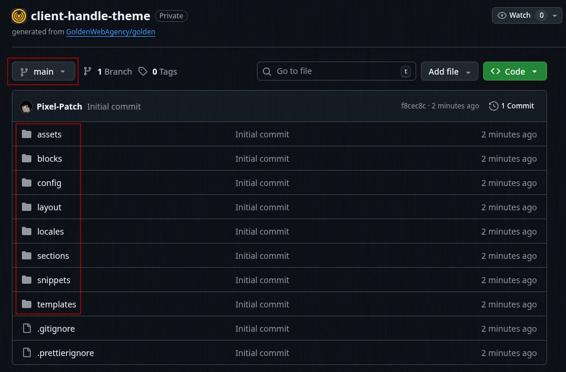
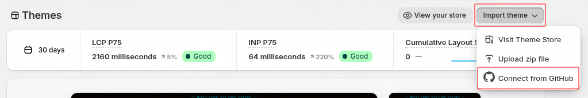
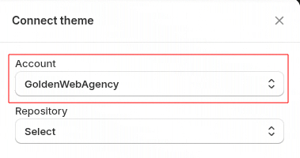
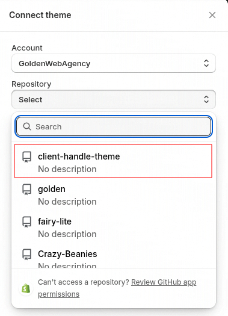
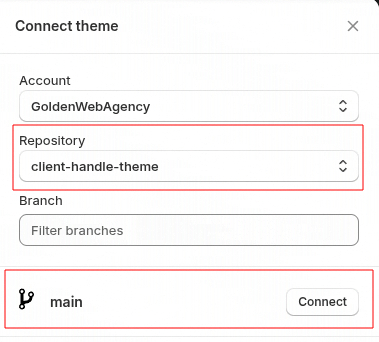
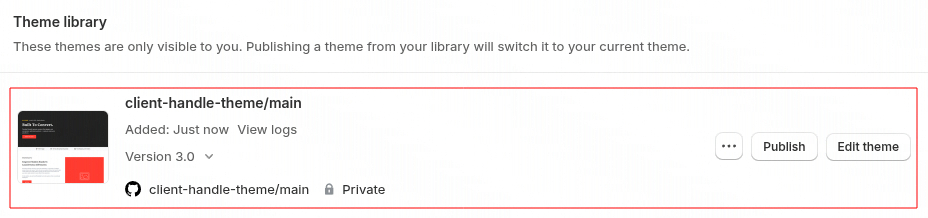

# SOP: Create and connect a new client Shopify theme repo

## Purpose

Use this process every time we start a new client theme project so each client has:

- Their own private GitHub repository
- A clean local theme workspace
- A production-ready Golden theme connected to Shopify through GitHub

## Standard

- Use one repository per client theme project.
- Use a private GitHub repository.
- Keep `main` as the branch connected to Shopify unless there is a clear reason not to.
- Keep the Shopify theme folder structure at the repo root.

## Access requirements

Before starting, confirm all of the following:

1. We have store access with `Themes` or `Manage themes` permission.
2. We have access to the GitHub org or account where the repo will live.
3. We have write access to the repository and branch we want to connect.
4. If we are using the agency org, we can authorize the Shopify GitHub app for the client repo.

## Workflow

### 1. Create the client repo from the template

Recommended naming pattern: `<client-handle>-theme`

1. Open the `golden` repository in GitHub.
2. Click `Use this template`.

   

3. Choose the correct owner.

4. Enter the client repository name.

5. Set the visibility to `Private`.

6. Click `Create a new repository`.

   

7. Confirm the new repo was created with the Golden theme files on `main`.

   

8. _(Required if you edit locally in an IDE — skip only if you work exclusively in the Shopify theme editor)_ Clone the new repository locally:

   ```bash
   git clone <github-repo-url>
   ```

   Then run `npm install` once to activate local pre-commit validation. **This is the only check that runs on your changes before they sync to Shopify, so don't skip it** (see **Local validation** under Method 1 below).

9. _(If you cloned in step 8)_ Open the project folder and confirm the Shopify theme folder structure is at the root:

   ```
   <client-handle>-theme/
   ├── assets/                  # Shopify theme structure
   ├── blocks/                  #   (these 8 folders are required
   ├── config/                  #    to connect the repo via GitHub)
   ├── layout/
   ├── locales/
   ├── sections/
   ├── snippets/
   ├── templates/
   ├── .husky/
   │   └── pre-commit           # pre-commit hook → runs the checks below
   ├── scripts/
   │   └── validate-schema.mjs  # schema/JSON guard (rules Theme Check misses)
   ├── .theme-check.yml         # Theme Check config
   ├── .prettierrc              # Prettier config
   ├── .prettierignore
   ├── package.json             # npm scripts + Husky/lint-staged config
   ├── package-lock.json
   └── README.md
   ```

   Note: `node_modules/` and `docs/` are gitignored — they won't appear in a fresh clone (`node_modules/` is created by `npm install`).

### 2. Authorize the Shopify GitHub app

In Shopify admin:

1. Go to `Online Store -> Themes`.
2. Click `Import theme -> Connect from GitHub`.

   

3. Click the button to log in to GitHub.

   <!--  -->
   <!-- SCREENSHOT: GitHub login/authorize button inside Shopify -->

   <!-- > **Screenshot:** [Add screenshot of the GitHub login button shown in Shopify] -->

4. On the `Install Shopify` screen, choose `GoldenWebAgency`.

   <!--  -->
   <!-- SCREENSHOT: Install Shopify screen where you choose the GitHub org -->

   <!-- > **Screenshot:** [Add screenshot of the "Install Shopify" screen with GoldenWebAgency selected] -->

5. On the `Request Shopify` screen, choose `All repositories`.

   <!--  -->
   <!-- SCREENSHOT: Request Shopify screen with All repositories selected and Request button visible -->

   <!-- > **Screenshot:** [Add screenshot of "Request Shopify" screen with "All repositories" selected] -->

6. Click `Request`.

Notes:

- If approval is required, ask the GitHub org owner to approve the Shopify app request. You can check the pending request status under `Settings -> Third-party access -> GitHub Apps` in the GitHub org.

### 3. Connect the repo and branch in Shopify

After the GitHub app is authorized:

1. Return to `Online Store -> Themes`.
2. Click `Import theme -> Connect from GitHub` again if needed.
3. In the `Connect theme` pane, select the correct GitHub org or account.

   

4. Under `Repository`, select the client repo.

   

5. Under `Branch`, select `main`.

   

6. Complete the connection.

   

Result:

- Shopify creates a theme in the themes page connected to that branch.
- Future commits to the connected branch sync into Shopify.
- Changes saved in the Shopify theme editor or code editor sync back to GitHub as commits from Shopify.

### 4. Publish when ready

Since Golden is production-ready, the connected theme is ready to upload and publish after QA or client approval.

- Publish the connected theme from the theme library when it is approved.
- If you want a safer review flow, keep it unpublished until QA is complete.

### 5. Set the working rules for the project

After the repo is linked, follow these rules:

- Treat the connected GitHub branch as the source of truth.
- Do normal feature work in branches and merge to `main`.
- Keep the published theme separate from the connected draft theme until QA is complete.
- If a temporary campaign or seasonal theme is needed, use a separate branch and connect that branch as a separate theme.
- Remember that edits made in Shopify are pushed back to GitHub automatically and this cannot be disabled.

## Git workflow

This section covers how all developers manage code changes — both inside client repos and when contributing improvements back to the golden repo.

### How the flow works

```
Client A repo (Dev A or Main Dev)          Golden repo (Main Dev)
─────────────────────────────────          ──────────────────────
main (Shopify connected)                   main (master template)
  │
  ├── fix/issue-name  ──→ PR ──→ main
  │                               │
  ├── feat/feature-name ──→ PR ──→ main
  │                               │
  │              generic? ────────┴──→ branch on golden ──→ PR ──→ golden main
  │                                                              (main dev reviews)
Client B repo (Dev B)
─────────────────────
main (Shopify connected)
  │
  ├── fix/another-issue ──→ PR ──→ main
  │                                │
  │              generic? ─────────┴──→ branch on golden ──→ PR ──→ golden main
  │                                                              (main dev reviews)
```

### Method 1: Client repo workflow

Every developer follows this for their assigned client repos.

**Rules:**

- `main` is connected to Shopify — never push directly to it.
- All work goes through a branch and a pull request, no exceptions.
- Use descriptive branch names so anyone can trace what the branch is for.

**Branch naming:**

- Bug fix: `fix/<short-description>` — e.g. `fix/header-logo-overflow`
- New feature: `feat/<short-description>` — e.g. `feat/sticky-announcement-bar`

**Step by step:**

1. Clone the client repo (first time only):

   ```bash
   git clone <client-repo-url>
   cd <client-handle>-theme
   ```

2. Pull the latest `main` before starting:

   ```bash
   git checkout main
   git pull origin main
   ```

   > **Local validation (required for IDE editing, one-time setup).** If you edit this repo in an IDE, run `npm install` once after cloning. This triggers the `prepare` script (Husky) and activates the pre-commit hook that auto-formats staged files and runs Shopify Theme Check before every commit. It's the only validation on the IDE path, so don't skip it.
   >
   > - Requires the Shopify CLI (`shopify theme check`) — install with `npm i -g @shopify/cli` if missing.
   > - Emergency bypass: `git commit --no-verify` (or `HUSKY=0 git commit ...`).
   > - **Coverage:** this hook only validates commits you make locally. Edits saved in the Shopify theme editor commit from Shopify's servers and bypass it — so validate your IDE work before pushing.

3. Create a new branch:

   ```bash
   git checkout -b fix/header-logo-overflow
   # or
   git checkout -b feat/sticky-announcement-bar
   ```

4. Make your changes, then stage and commit:

   ```bash
   # Stage all changed files at once
   git add .

   # Or stage only a specific file
   git add sections/header.liquid

   git commit -m "fix(header): constrain logo overflow on mobile"
   ```

5. Push the branch to GitHub:

   ```bash
   git push -u origin fix/header-logo-overflow
   ```

6. Open a pull request on GitHub from your branch to `main`.
7. Request a review if needed.
8. After approval, merge the PR.
9. Shopify auto-syncs the merged change to the connected theme.

---

### Method 2: Contributing a fix or feature back to golden

Use this when a change you made in a client repo is **generic enough to benefit all future projects**.

**Ask yourself: is this client-specific or theme-universal?**

| Client-specific (stay in client repo) | Generic (port to golden)                                        |
| ------------------------------------- | --------------------------------------------------------------- |
| Client's brand colors or fonts        | A reusable section or snippet pattern                           |
| A layout unique to this store         | A performance fix (lazy loading, CSS optimization)              |
| Promo content or campaign logic       | An accessibility improvement                                    |
| Client-requested one-off feature      | A bug fix that could appear in any store                        |
|                                       | A feature built for one client but useful for all future stores |

> If you are unsure whether a client-specific feature belongs in golden, discuss with the team before porting.

**Step by step:**

1. Clone the golden repo (first time only):

   ```bash
   git clone <golden-repo-url>
   cd golden
   ```

2. Pull the latest `main` before starting:

   ```bash
   git checkout main
   git pull origin main
   ```

3. Create a new branch:

   ```bash
   git checkout -b fix/header-logo-overflow
   # or
   git checkout -b feat/sticky-announcement-bar
   ```

4. Port the change cleanly into golden:
   - Remove any client-specific values (colors, names, content).
   - Keep the logic generic and reusable.
   - Test locally if possible.

5. Commit and push:

   ```bash
   # Stage all changed files at once
   git add .

   # Or stage only a specific file
   git add sections/header.liquid

   git commit -m "fix(header): constrain logo overflow on mobile"
   git push -u origin fix/header-logo-overflow
   ```

6. Open a pull request on GitHub from your branch to `main`.
7. The **main dev reviews and merges** all PRs on golden.

---

### Rules for all developers

- Never commit directly to `main` in any repo.
- One branch per issue or feature — keep branches focused.
- Write clear commit messages: `type(scope): short description` (e.g. `feat(cart): add quantity stepper`).
- Before opening a PR to golden, confirm the change has no client-specific code.
- If unsure whether something belongs in golden, ask the team first.

## Handoff and ownership

At project start, decide who owns the repository long term:

- agency-owned during active development
- transferred to the client at handoff
- client-owned from day one

Document that decision before launch.

## Do not do this

- Do not reuse another client's repository.
- Do not connect the wrong branch to the wrong store.
- Do not use a repo or branch that does not match Shopify's default theme structure.

## Troubleshooting notes

- If the repository does not appear in Shopify, the GitHub org owner may need to update the Shopify app's repository access.
- Only repositories with write access can be used to create a new theme connection.
- Only branches that match Shopify's default theme folder structure can be connected.
- Outside collaborators cannot connect organization branches. Use a proper org member account with write access.
- If a new dev store or transfer store fails during the first GitHub app setup, log out of Shopify and log back in before trying again.
- If a branch is disconnected, reconnecting it creates a new theme instead of reconnecting the old one.

## Quick checklist

- Private GitHub repo created
- Golden template used
- Shopify GitHub app authorized
- Shopify theme connected from GitHub
- Repo ownership decided
