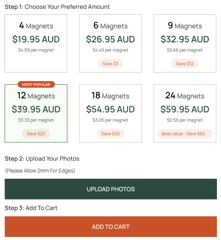
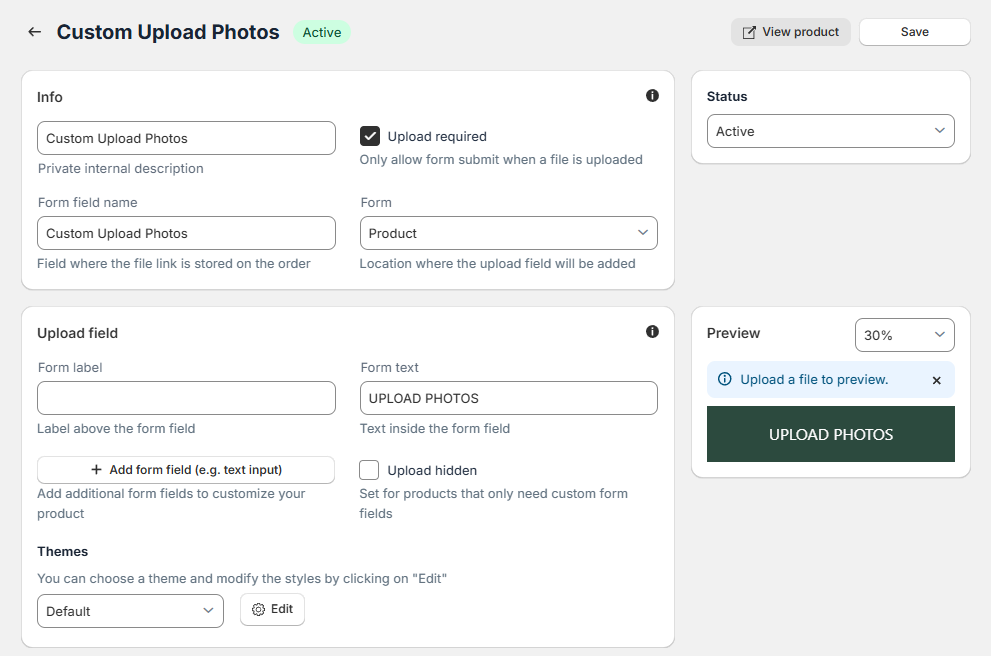
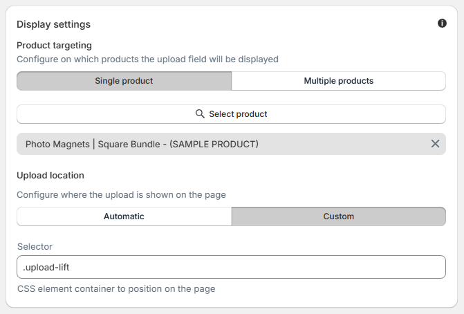
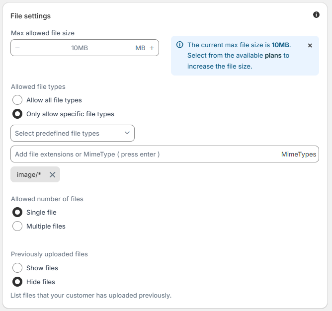
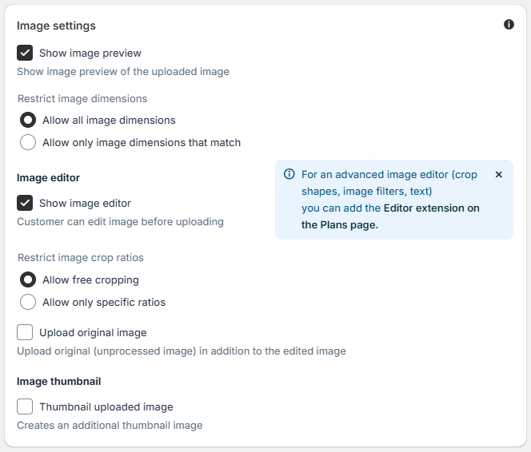
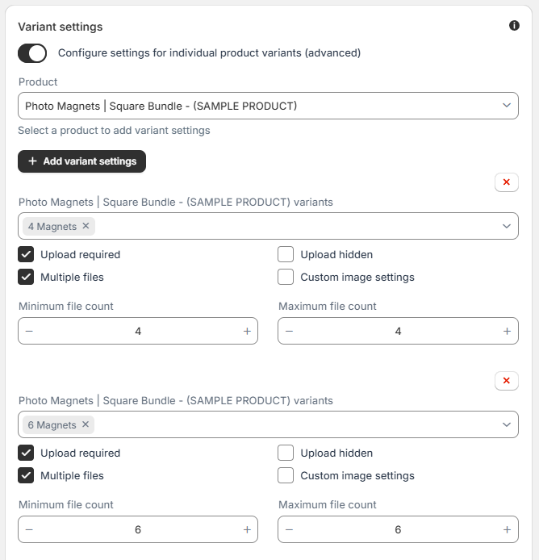

# Custom Magnet Photos

A replication guide for the **custom photo-magnets purchase flow** built on the Golden theme. Use
this to set the feature up again for a future client that needs "pick a quantity → upload that many
photos → add to cart."

> **Scope of this doc:** how the feature is assembled (the **Upload Lift** app + a theme **mount
> block** + an optional **variant-card selector**). The current reference build lives in the
> `just-magnets` theme; file paths below point there so a developer can copy/adapt the code.

---

## Overview

The feature is three independent parts that work together on the product page:

| Part | What it does | Provided by |
|---|---|---|
| **1. Upload Lift app** | Renders the "UPLOAD PHOTOS" button + file upload/cropping, and stores the file link on the order. Required photo count is driven by the selected variant. | Shopify app (config only — no theme code) |
| **2. App-mount block** | An empty `<div>` with a CSS class. Upload Lift is told to inject its widget *into this div* (its "Custom" placement). | Theme block |
| **3. Variant-card selector** *(optional)* | Replaces the default variant picker with a card grid (count, price, per-magnet price, savings, "Most Popular"/"Best value"). | Theme snippet |

**End-to-end flow:**

```
Step 1  Choose amount         →  variant changes (e.g. "12 Magnets")
        (variant-card grid)       price / Add-to-Cart update
                                   Upload Lift now requires exactly 12 photos
Step 2  Upload your photos     →  customer uploads 12 images into the .upload-lift mount
        (Upload Lift widget)       (cropping/preview handled by the app)
Step 3  Add to cart           →  variant + uploaded file link added to the order
```

**Prerequisites**
- The **Upload Lift** app installed on the store. *(Upload Lift is a Shopify app that adds a
  customer photo/file upload field to a product and saves the uploaded file on the order.)*
- A product whose variants are quantity tiers (option named **"Magnets"**, values **"4 Magnets",
  "6 Magnets", …**). The optional card selector and the per-variant upload counts both rely on this.

---

## Design reference

The Figma design this feature was built to — extracted color/type tokens, frame links, and the
final-result mockups — lives in **[`design-reference.md`](design-reference.md)**.

**Figma frames (dev mode):**
- Step 1 — Variant cards: [desktop](https://www.figma.com/design/ryC2JWj8nMGgrgz9NVqYzz/JustMagnets.com.au?node-id=6345-124&m=dev) · [mobile](https://www.figma.com/design/ryC2JWj8nMGgrgz9NVqYzz/JustMagnets.com.au?node-id=6022-577&m=dev)
- Step 2 + Step 3 — Upload & Add to Cart: [desktop](https://www.figma.com/design/ryC2JWj8nMGgrgz9NVqYzz/JustMagnets.com.au?node-id=2002-3215&m=dev) · [mobile](https://www.figma.com/design/ryC2JWj8nMGgrgz9NVqYzz/JustMagnets.com.au?node-id=2002-3263&m=dev)



*(Mobile mockup: [design-reference-mobile.png](images/design-reference-mobile.png).)*

---

## Part 1 — Upload Lift app setup

All of this is configured **inside the Upload Lift app** (Shopify admin → Apps → Upload Lift →
create/edit an upload). No theme code is involved here.

### 1a. Info & button text


- **Private internal description**: `Custom Upload Photos` (admin-only label).
- **Upload required**: ✅ ON — the customer cannot submit the product form until a file is uploaded.
- **Form field name**: `Custom Upload Photos` — this is the property the uploaded **file link is
  stored under on the order**.
- **Form**: `Product` — the upload field is added to the product page.
- **Form text**: `UPLOAD PHOTOS` — the label shown inside the upload button.
- **Theme**: `Default` — styling is tweaked via the app's *Edit*; the theme can also override the
  widget's CSS to match the design (in this build the button is the green `#2C4A3E` "UPLOAD PHOTOS"
  pill, styled by theme CSS targeting the app's drop-label).

### 1b. Display — where the widget appears (the key hook)


- **Product targeting**: `Single product` → the photo-magnets bundle.
- **Upload location**: **`Custom`**
- **Selector**: **`.upload-lift`**

This is the link between the app and the theme: Upload Lift injects its "UPLOAD PHOTOS" widget into
**whatever element on the page matches `.upload-lift`**. The theme provides that element via the
mount block (Part 2).

> **Alternative placement — "Automatic":** instead of `Custom`/`.upload-lift`, set **Upload location
> = Automatic** and add the **Upload Lift app block** directly in the theme editor (Add block →
> Apps → Upload Lift) where you want it. Then you do **not** need the custom mount block — pick one
> approach or the other, not both.

### 1c. File settings


- **Max allowed file size**: `10MB` (plan-dependent).
- **Allowed file types**: *Only allow specific file types* → `image/*`.
- **Allowed number of files**: `Single file` *(global default — overridden per variant in 1e)*.
- **Previously uploaded files**: `Hide files`.

### 1d. Image settings


- **Show image preview**: ✅
- **Restrict image dimensions**: *Allow all image dimensions*.
- **Image editor**: ✅ *Show image editor* — customers can crop/adjust before uploading;
  *Allow free cropping*.
- *Upload original image* and *Thumbnail* left off.

### 1e. Variant settings — required photo count per variant *(important)*


Turn on **"Configure settings for individual product variants (advanced)"**, select the product,
then **Add variant settings** for each tier. For each variant set the **Minimum** and **Maximum file
count equal to the magnet count**:

| Variant | Upload required | Multiple files | Min files | Max files |
|---|---|---|---|---|
| 4 Magnets | ✅ | ✅ | 4 | 4 |
| 6 Magnets | ✅ | ✅ | 6 | 6 |
| 9 Magnets | ✅ | ✅ | 9 | 9 |
| 12 Magnets | ✅ | ✅ | 12 | 12 |
| 18 Magnets | ✅ | ✅ | 18 | 18 |
| 24 Magnets | ✅ | ✅ | 24 | 24 |

This is what makes the upload requirement **follow the selected variant** — choosing "12 Magnets"
forces the customer to upload exactly 12 images. (These per-variant rows override the global
"Single file" setting from 1c; any variant without its own row falls back to those global settings.)

---

## Part 2 — The app-mount block ("App Embed Mount")

A tiny theme block whose only job is to output an **empty container with a CSS class** that an app
targets. Here it produces `<div class="upload-lift"></div>`, which Upload Lift's *Custom* selector
(Part 1b) fills with the "UPLOAD PHOTOS" widget. Optionally it also renders a heading and a note
above the mount.

In this build it renders, in order (12px gap):

1. Heading — "**Step 2:** Upload Your Photos"
2. Note — "(Please Allow 2mm For Edges)"
3. The empty mount `<div class="upload-lift"></div>`

### Make it reusable (recommended): a custom-class setting

So the same block works for **any** app that supports custom-class placement (not just Upload Lift),
expose the class as a setting instead of hardcoding it:

- Add a **"Container class"** text setting (default: `upload-lift`).
- Render the div with that setting: `<div class="{{ block.settings.custom_class | default: 'upload-lift' }}"></div>`.

Then for a different app you only change the setting and the app's own "custom selector" value to
match — no code edit. Rename the block to a generic name (e.g. **"App Embed Mount"**) so its purpose
is clear in the editor.

### Reference implementation (just-magnets theme)
- Snippet: `snippets/pdp-photo-upload.liquid` — heading + note + `<div class="upload-lift">`.
- Block type: `photo_upload`, registered in the product section schema (`sections/product.liquid`)
  and named **"Photo Upload"** in `locales/en.default.schema.json`.
- Live instance: in `templates/product.json`, placed **between the Variant Selector and Add to
  Cart** in the block order.
- ⚠️ The current build **hardcodes** the `upload-lift` class. The custom-class setting above is the
  recommended generalization for reuse.

---

## Part 3 — Variant-card selector *(OPTIONAL)*

> Only needed for products that sell **quantity tiers** and want the marketing card grid. If a
> future client just needs photo uploads on a normal product, skip this part entirely — Parts 1 & 2
> are enough.

Instead of the default swatch/pill picker, the "Magnets" option renders as a card grid ("**Step 1:
Choose Your Preferred Amount**"). Each card shows the count, total price, per-magnet price, an
optional savings badge, and optional "MOST POPULAR" / "Best value" markers. Selecting a card switches
the active variant immediately — like the normal picker, with no separate confirm step (the cards
are hidden radio inputs).

It triggers when the product option is named **"Magnets"** (or its values contain "Magnet").

### The numbers on each card

**Per-magnet price** — always **computed**: `price ÷ count`.

**Savings ("Save $X")** — choose one of two sources:

- **Computed** *(default)* — `round(count × base_rate − price)`, where `base_rate` is the smallest
  tier's per-magnet price. No setup; derives from the variant prices.
- **Variant metafield** — `custom.savings` (Number, whole dollars). The card renders `Save $` +
  value. Use this if a future store can't rely on the computed model.

Worked example (the live tiers — both methods produce the same display):

| Count | Total | Per magnet (`price ÷ count`) | Save (`count × $4.99 − price`) | Marker |
|---|---|---|---|---|
| 4 | $19.95 AUD | $4.99 | — | — |
| 6 | $26.95 AUD | $4.49 | $3 | — |
| 9 | $32.95 AUD | $3.66 | $12 | — |
| 12 | $39.95 AUD | $3.33 | $20 | **MOST POPULAR** |
| 18 | $54.95 AUD | $3.05 | $35 | — |
| 24 | $59.95 AUD | $2.50 | $60 | **Best value -** prefix |

*(base_rate = $19.95 ÷ 4 = $4.9875; savings round to whole dollars.)*

**Markers ("MOST POPULAR" / "Best value")** — these can't be derived from price; choose one source:

- **Theme settings** *(default)* — the **Variant Selector** block exposes **"Most popular amount"**
  (e.g. `12`) and **"Best value amount"** (e.g. `24`). The card whose count matches gets the badge.
- **Variant metafield** — `custom.variant_badge` (single-line text) with value `most_popular` or
  `best_value` (blank = none). `most_popular` → the top badge; `best_value` → "Best value -" prefix
  on that card's Save badge.

### Setting up the variants in admin
1. Product option named **`Magnets`**, values **`4 Magnets`, `6 Magnets`, … `24 Magnets`**.
2. Set each variant's **price** (and Compare-at price if you use compare-at savings elsewhere).
3. If using the **metafield** options, create variant metafield definitions:
   - `custom.savings` — *Number (integer)*, the whole-dollar savings.
   - `custom.variant_badge` — *Single line text*, values `most_popular` / `best_value`.

### Reference implementation (just-magnets theme)
- Card grid: `snippets/pdp-variant-magnets.liquid`.
- Branch that swaps the default picker for the cards: `snippets/pdp-variant-selector.liquid`
  (``).
- Marker settings: on the `variant_selector` block in `sections/product.liquid`
  (`most_popular_amount` / `best_value_amount`).

---

## How it all connects

1. **Choose amount (Part 3)** → the variant changes. `assets/variant-selector.js` surgically updates
   the price, Add-to-Cart state, and the picker — **without re-rendering the whole product
   information** — so the Upload Lift widget and other app blocks stay mounted (see note below).
2. The new variant has its own **required photo count** (Part 1e), so the upload widget now expects
   exactly that many images.
3. **Upload (Parts 1 + 2)** → Upload Lift renders into the `.upload-lift` mount; the customer uploads
   and optionally crops the required number of photos.
4. **Add to cart** → the product form submits the selected variant plus the uploaded **file link**,
   saved on the order line as a **line-item property** named "Custom Upload Photos" (the *Form field
   name* from 1a).

> **Critical theme behavior:** the variant picker must **not** replace the entire product-info
> container on variant change — doing so wipes the app-injected DOM and the upload widget
> "disappears." The reference theme updates only price / Add-to-Cart / installments / picker and
> leaves app mounts untouched (`assets/variant-selector.js`).

---

## Replication checklist (new client)

1. **Install Upload Lift** on the store.
2. **Configure the upload** per Part 1: Form field name, `UPLOAD PHOTOS` text, **Upload required**,
   **Display → Custom → `.upload-lift`** (or Automatic + app block), file/image settings, and the
   **per-variant min=max file counts**.
3. **Add the mount block** so the page contains `<div class="upload-lift"></div>` where the widget
   should appear (use the custom-class setting for non-Upload-Lift apps). *Skip if using Automatic
   placement + the app's own block.*
4. *(Optional)* **Add the variant-card selector** for quantity-tier products; pick the savings source
   (computed or `custom.savings`) and markers source (theme settings or `custom.variant_badge`), and
   create the metafield definitions if used.
5. **Verify**: selecting a tier updates price + required photo count, the upload widget stays
   mounted, and a test order records the uploaded file link.

### Files to copy from the reference theme
- `snippets/pdp-photo-upload.liquid` (mount block)
- `snippets/pdp-variant-magnets.liquid` + the `Magnets` branch in `snippets/pdp-variant-selector.liquid` *(optional cards)*
- The `photo_upload` block (+ `variant_selector` marker settings) in `sections/product.liquid`, and the block instance in `templates/product.json`
