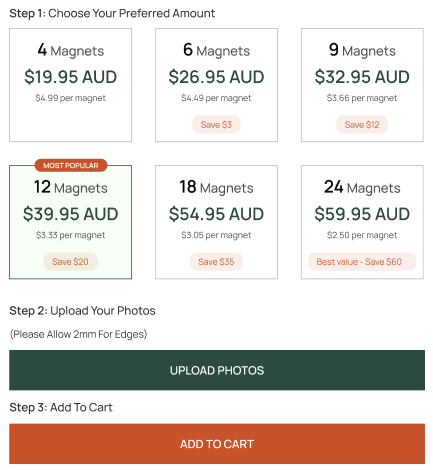
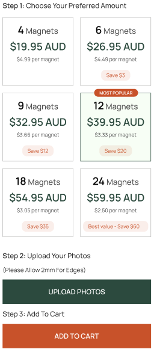

# Custom Magnet Photos — Design Reference

Figma design context for the custom magnet-photos product page — the **source of truth** the build
was matched against. See [`README.md`](README.md) for how the feature is assembled. *(Reference
only — no theme code here.)*

**Figma file:** [JustMagnets.com.au](https://www.figma.com/design/ryC2JWj8nMGgrgz9NVqYzz/JustMagnets.com.au) · key `ryC2JWj8nMGgrgz9NVqYzz`

---

## Final result

**Desktop**

**Mobile**

The flow, top to bottom: **Step 1** quantity cards → **Step 2** upload (Upload Lift "UPLOAD PHOTOS")
→ **Step 3** "ADD TO CART" → trust row.

---

## Figma frames (dev mode)

| Area | Desktop | Mobile |
|---|---|---|
| **Step 1** — Variant cards ("Choose Your Preferred Amount") | [node `6345-124`](https://www.figma.com/design/ryC2JWj8nMGgrgz9NVqYzz/JustMagnets.com.au?node-id=6345-124&m=dev) | [node `6022-577`](https://www.figma.com/design/ryC2JWj8nMGgrgz9NVqYzz/JustMagnets.com.au?node-id=6022-577&m=dev) |
| **Step 2 + Step 3** — Upload & Add to Cart (+ trust row) | [node `2002-3215`](https://www.figma.com/design/ryC2JWj8nMGgrgz9NVqYzz/JustMagnets.com.au?node-id=2002-3215&m=dev) | [node `2002-3263`](https://www.figma.com/design/ryC2JWj8nMGgrgz9NVqYzz/JustMagnets.com.au?node-id=2002-3263&m=dev) |

---

## Design tokens

### Colors

| Token | Hex | Used for |
|---|---|---|
| Primary/600 | `#2C4A3E` | Total price, UPLOAD PHOTOS button bg, selected-card border |
| Primary/100 | `#F7FEF5` | Selected / most-popular card background |
| Accent | `#C8522A` | "Save $X" text, MOST POPULAR badge bg, ADD TO CART button bg |
| Accent @ 10% | `rgba(200,82,42,0.1)` | "Save $X" badge background |
| Secondary/500 | `#333333` | Step headings & note |
| Neutral/600 | `#0A0A0A` | Card count number |
| Neutral/500 | `#4E4E4E` | "Magnets" word, per-magnet text, trust labels |
| Neutral/300 | `#B9B9B8` | Card border |
| White | `#FFFFFF` | Button text |
| Secondary/200 | `#F1F3F5` | Section divider (desktop Step 2+3) |
| Neutral/200 | `#E8E8E7` | Section divider (mobile Step 2+3) |

### Typography — Manrope (line-height 1.4, letter-spacing 0)

| Token | Size / weight | Used for |
|---|---|---|
| H4 | 24 / 600 | Card count number, total price |
| Subtitle 1 | 20 / 500 | (spacer between count and "Magnets") |
| Body Highlight | 16 / 600 | "Step N:" prefix, button labels |
| Body Medium | 16 / 500 | Step heading body ("Upload Your Photos"), "Magnets" word (18/500 on cards) |
| Body Small | 14 / 400 | "(Please Allow 2mm For Edges)" note |
| Menu Options | 12 / 400 | Per-magnet price, "Save $X", trust labels |
| — | 10 / 700 | MOST POPULAR badge |

---

## Per-frame specs

### Step 1 — Variant cards · desktop `6345-124` / mobile `6022-577`
- Heading: "**Step 1:** Choose Your Preferred Amount" (Body-Highlight 16/600 + Body-Medium 16/500, `#333`).
- Grid: flex-wrap, `justify-center`, gap **32px** desktop / **16px** mobile.
- Card: width **170px** desktop / **163px** mobile; border `1px #B9B9B8`; padding `12px 11px`; column, centered, inner gap `16px`.
- Count: `<strong>` 24/600 `#0A0A0A` + " Magnets" 18/500 `#4E4E4E`.
- Total price: 24/600 `#2C4A3E` (e.g. "$19.95 AUD").
- Per-magnet: 12/400 `#4E4E4E` (e.g. "$4.99 per magnet").
- Save badge: bg `rgba(200,82,42,0.1)`, text `#C8522A` 12/400, padding `4px 12px`, radius `10px`.
- MOST POPULAR: absolute, `top: -10px`, centered; bg `#C8522A`, white 10/700, padding `2px 12px`, radius `10px`. That card uses bg `#F7FEF5` + border `#2C4A3E`.

### Step 2 + Step 3 — Upload & Add to Cart · desktop `2002-3215` / mobile `2002-3263`
- Container: flex column, gap **12px**; bottom border `#F1F3F5` (desktop, `padding-bottom 32`) / `#E8E8E7` (mobile, `padding-bottom 24`).
- **Step 2** heading "**Step 2:** Upload Your Photos" (16/600 + 16/500 `#333`); note "(Please Allow 2mm For Edges)" 14/400 `#333`.
- **UPLOAD PHOTOS** button: bg `#2C4A3E`, white 16/600, height `56px`, padding `10px 40px`, full width. *(Rendered by the Upload Lift app into the `.upload-lift` mount.)*
- **Step 3** heading "**Step 3:** Add To Cart" (16/600 + 16/500 `#333`).
- **ADD TO CART** button: bg `#C8522A`, white 16/600, height `56px`, padding `10px 40px`, full width.
- Trust row: 3 items, each = 24px icon + label (12/400 `#4E4E4E`), gap `8px`. Desktop: single row, `space-between`. Mobile: 3 equal centered columns.

### Mapping to theme blocks (reference implementation)
| Design area | Theme block / snippet |
|---|---|
| Step 1 cards | `snippets/pdp-variant-magnets.liquid` (via `pdp-variant-selector.liquid`) |
| Step 2 — upload mount | `photo_upload` block → `snippets/pdp-photo-upload.liquid` (`.upload-lift`) |
| Step 3 — Add to Cart | `atc` block → `snippets/pdp-add-to-cart.liquid` |
| Trust row | `guarantee_text` block → `snippets/pdp-guarantee-text.liquid` |
